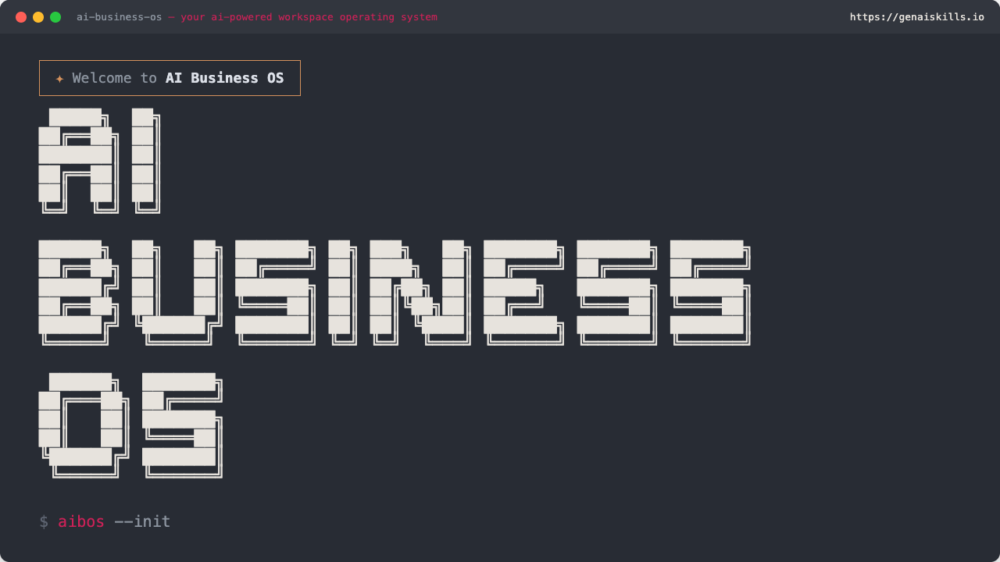

<p align="center">
  
</p>

# AI Business OS

**Engine version:** v3.0.1

> ## Join the GenAI Skills Academy Community
>
> GenAI Skills Academy builds and maintains AI Business OS. Its learning community publishes AI news and updates to AI Business OS and the PRIMA suite. Members also get articles and free and paid resources for extending this workspace. That includes the skill packs that once shipped inside it. Join at [learn.genaiskills.io/learning-community](https://learn.genaiskills.io/learning-community).

AI Business OS is the AI model-agnostic business operating system that allows you to use any AI agent on your local business file system. The OS is designed specifically for knowledge-based professional work, for businesses of one and upwards providing you with a framework and methodology for AI deployment in your business. Once installed, you get a structured workspace specifically designed to help you manage projects and client and supplier relationships related to those projects. You can use any AI agent or agent harness you wish with the AI Business OS, including Claude Code, Codex, Hermes Agent and OpenCode, and even local open weight models through Ollama.

Full documentation is at [docs.genaiskills.io](https://docs.genaiskills.io/ai-business-os/overview/).

## Claude Code and Other AI Agents

AI Business OS is built and tested with Claude Code, which loads `.claude/CLAUDE.md` automatically at the start of every session. Most other AI agents read a file named `AGENTS.md` instead, so the workspace carries one at its root and a pointer in every domain and project folder. Each `AGENTS.md` sends the agent to the same instructions, company files and project register that Claude Code reads, and `.claude/docs/agent-agnostic-design.md` sets out the design rules behind this. Another agent can work in the workspace, although some commands, hooks and skills may behave differently with it. If you use one, tell GenAI Skills Academy what works and what does not at larry@genaiskills.io, because that feedback is valued.

## Quick Start

1. Open VS Code with Claude Code installed
2. Paste the install prompt from your purchase email into Claude Code; Claude installs the workspace from `git.genaiskills.io` using your key (no GitHub account needed)
3. Run `/setup` to personalise your workspace
4. Run `/day` to start your first session

## What's Included

### Folder Structure
```
your-biz-os/
├── .claude/                          Agent configuration (the engine)
│   ├── agents/                       Agent definitions
│   ├── commands/                     Slash commands (/day, /night, etc.)
│   ├── company/                      Your organisation context (voice, brand, team, etc.)
│   ├── config/                       Workspace configuration
│   ├── docs/                         Documentation and guides
│   ├── rules/                        Behavioural rules (auto-loaded)
│   ├── skills/                       Reusable workflow skills
│   └── state/                        Project state and schema
├── .vscode/                          VS Code settings and extensions
├── Archive/                          Completed or retired items
├── Documentation/                    Templates and reports
├── Domains/                          All business work, filed by function
│   ├── 01 Clients/                   One folder per client
│   ├── 02 Finance/                   Accounts, budgets, tax, reporting
│   ├── 03 Human Resources/           Recruitment, policies, internal training
│   ├── 04 Information Technology/    Systems, security, runbooks, software
│   ├── 05 Strategy & Leadership/     Board, decisions, OKRs, strategy
│   ├── 06 Sales/                     Pipeline, proposals, contracts
│   ├── 07 Marketing/                 Campaigns, content, brand, social media
│   ├── 08 Communications/            Press, stakeholders, internal comms, crisis
│   ├── 09 Customer Service/          Tickets, knowledge base, service levels
│   ├── 10 Operations/                Processes, logistics, quality, vendors
│   ├── 11 Procurement/               Suppliers, RFQs, agreements
│   ├── 12 Property & Facilities/     Leases, assets, maintenance, insurance
│   ├── 13 Products/                  Catalogue, development, pricing
│   ├── 14 Research & Development/    Market scans, prototypes, patents
│   ├── 15 Education & Training/      Courses, curriculum, learners, assessments
│   ├── 16 Legal & Compliance/        Contracts, IP, audits, data protection, risk
│   └── 99 Cross-Domain/              Projects spanning three or more domains
├── Infrastructure/                   Engine scripts and hooks
│   └── Scripts/                      Update, install, and validation scripts
└── Scripts/                          Operational scripts (PRIMA-managed)
```

Each domain holds a `CLAUDE.md`, numbered reference subfolders for standing material (`02.1`, `02.2`, ...) and tracked projects (`{ID} {Project Name}/`). Domains are numbered `01` to `16` plus `99` for consistent sort order and uses hierarchical subfolder numbering (e.g., `02.1`, `02.2`). See [Folder Structure](.claude/docs/folder-structure.md) for a full guide, including how reference material and tracked projects share a domain.

Workspaces installed from an earlier version keep their `Projects/`, `Clients/` and department folders. `/update` never moves folders, and `/newproject` and `/newclient` detect which layout is present.

### Commands
| Command | Purpose |
|---------|---------|
| `/setup` | First-time personalisation wizard |
| `/day` | Morning briefing — sync, scan projects, suggest priorities |
| `/night` | End-of-session — summarise work, commit, push |
| `/save` | Mid-session save — capture current state and return a resume reference before context limits are reached |
| `/status` | Overview of all projects and recent activity |
| `/sync` | Quick commit and push |
| `/newproject` | Create a new project folder |
| `/newclient` | Create a new client folder |
| `/install-pack` | Install an extension pack into the workspace |
| `/update` | Check for and apply engine updates |
| `/resume` | Resume a previous session from a project ID, a time or a search term, and show where you left off |
| `/dashboard` | Generate an HTML project dashboard from `state.json` and open it in the browser |
| `/migrate-company` | Convert a legacy `CLIENT_PROFILE.md` into the six `.claude/company/` files, with a walkthrough for thin areas |

### Skills (7 built-in)
- **Processing PDFs** — extract, merge, split with automatic large-file handling (5-level scale)
- **Documenting workflows** — SOPs, checklists, playbooks, onboarding guides, process maps
- **Drafting documents** — proposals, reports, briefs, memos
- **Meeting notes** — structured summaries from meeting content
- **Client setup** — new client onboarding
- **Status reports** — workspace activity summaries
- **Creating skills** — build your own custom skills

#### Skills Removed in 3.0

Most of the skills from earlier versions no longer ship in the template. Anthropic, skills.sh and other trusted providers now publish skills in large numbers. Most workspace owners build or choose skills that fit their own work. The six removed skills are copywriting, search engine optimisation, email drafting, creating presentations, processing spreadsheets and processing documents. All six are available as skill packs in the GenAI Skills Academy community at [learn.genaiskills.io/learning-community](https://learn.genaiskills.io/learning-community). A workspace installed before 3.0 keeps any of these skills it already has. An update never deletes a file.

All skills read from `.claude/company/` for voice, brand, and audience context. Users can customise any skill — edits are preserved across engine updates via three-way merge, using the upstream copy of the version the workspace runs as the merge base. If that version is not in the upstream history, the latest backup in `.claude/engine-backups/` is the base; if neither exists, the update overwrites changed files, reports each one, and keeps the pre-update copies in `.claude/engine-backups/`.

### Rules
- Engine protection (three-tier file classification with PreToolUse hooks)
- Blocked commands (destructive action safeguards)
- Content defaults (language, tone, formality)
- File conventions (placement and naming)
- Autonomy levels (when Claude acts vs asks)
- PDF processing scale (5-level size classification)
- Checkpoint protocol (standardised approval points)
- Decomposition (choosing between an inline tool, a script, a skill or an agent)
- No permission prompts (act on direct edit requests without asking again)
- State validation (rules for reading and writing `state.json`)

## Project Tracking

AI Business OS includes lightweight project tracking out of the box — project IDs, status values, a `state.json` file, and `/day`, `/night`, `/status` commands that read and update project state.

### Upgrade: PRIMA Project Management

[PRIMA Project Management](https://github.com/larrygmaguire-hash/prima-plugin) (Project Registration, Indexing & Management Assistant) upgrades the built-in tracking with:

- Session memory — where you stopped, what you did last, searchable history
- Automatic checkpoints — structured progress snapshots written silently to disk
- Enhanced `/day`, `/night`, `/status` with priority routing, overdue detection, and recommended actions
- `/resume` command — pick up exactly where you left off
- `/timeline` command — interactive Gantt-style project timelines with scope selection
- Duplicate detection — prevents accidental project duplication
- Richer state management — priorities, pending items, session history with project cross-references

The base commands work without PRIMA Project Management. PRIMA Project Management replaces them with fuller versions.

**`/save` is not replaced by PRIMA Project Management.** It remains active in any AI Business OS workspace regardless of whether PRIMA Project Management is installed. Use `/save` whenever you want to manually capture a stable state mid-session — before context limits are reached, before switching to a different task, or before a complex operation. `/save` writes a checkpoint to disk, updates project records in `state.json`, and returns a timestamped reference (`/resume HH:MM`) for the next session. PRIMA Project Management's automatic checkpoints (every ~20 tool calls) and `/night` complement this but do not replace the deliberate save point that `/save` provides.

## PRIMA Ecosystem

AI Business OS is the base platform. The PRIMA family of add-ons extends it with project management, session memory, client relationship management, and academic research tools. Each component is a separate product. Install what you need.

| Component | Type | Requires | What It Does |
|-----------|------|----------|-------------|
| [PRIMA Project Management](https://github.com/larrygmaguire-hash/prima-plugin) | File-copy overlay | AI Business OS | Project management, enhanced commands, state tracking, session lifecycle, HTML dashboard with a Today view (1.5.0) |
| [PRIMA Memory](https://github.com/larrygmaguire-hash/prima-memory) | MCP server | AI Business OS | Session history search and context recovery across conversations |
| [PRIMA CRM](https://github.com/larrygmaguire-hash/prima-crm) | MCP server | PRIMA Project Management | Client and contact relationship management, scheduled interaction sync from the email, calendar and meetings providers declared in `integrations.json`, and a local HTML dashboard |
| [PRIMA Scholar](https://github.com/larrygmaguire-hash/prima-scholar) | Claude Code plugin | None (standalone) | Academic search, citation management, research library |

The authoritative source for component versions, dependencies, and install methods is `.claude/suite-registry.json`.

### Installing PRIMA Components

Each PRIMA component you buy comes with an install prompt in its purchase email. Open your workspace in VS Code, paste the prompt into Claude Code, and Claude installs the component from `git.genaiskills.io` using your key, then tells you when to restart. You do not need a GitHub account. PRIMA Scholar is free and installs from its public repository.

## Updating

AI Business OS separates **engine files** (rules, skills, commands, scripts) from **your files** (CLAUDE.md, company knowledge, state, configuration). Engine updates never touch your customisations.

An `engine-manifest.json` lists every file owned by the template. Only files in the manifest are updated — your custom skills, projects, client data, and configuration are never touched. Backups are saved before every update and can be rolled back.

### How updates are delivered

There are two models depending on your arrangement:

**Managed workspaces** — Larry maintains your workspace on your behalf. He clones your repository, applies engine updates, and pushes the changes. You receive updates automatically the next time you pull or start a session. No action required on your part.

**Self-service workspaces** — You manage your own updates. Run `/update` in Claude Code to check for new engine versions and apply them. Your repository needs read access to the upstream template (configured automatically on first run).

### Running updates yourself

To check for and apply updates:

```
/update
```

Or from the terminal:

```bash
bash Infrastructure/Scripts/update-engine.sh
```

| Flag | Purpose |
|------|---------|
| `--dry-run` | Preview changes without applying |
| `--rollback` | Restore the previous engine version |
| `--force` | Apply without confirmation prompt |

## Requirements

- [VS Code](https://code.visualstudio.com/)
- [Claude Code](https://claude.com/claude-code) (VS Code extension)
- Git
- A GitHub account (for template cloning and sync)
- **Windows users:** [WSL](https://learn.microsoft.com/en-us/windows/wsl/install) (Windows Subsystem for Linux) — see [Getting Started](.claude/docs/getting-started.md) for setup steps

## Documentation

Full documentation is in `.claude/docs/`:
- [Getting Started](.claude/docs/getting-started.md)
- [Folder Structure](.claude/docs/folder-structure.md)
- [Available Automations](.claude/docs/available-automations.md)
- [Capabilities Reference](.claude/docs/capabilities-reference.md)
- [Glossary](.claude/docs/glossary.md)
- [Cloud Sync Warning](.claude/docs/cloud-sync-warning.md)
- [Agent-Agnostic Design](.claude/docs/agent-agnostic-design.md)

## Platforms and Support

AI Business OS is built and tested on macOS. It may run on Windows through WSL or Git Bash, but Windows is not directly supported. No outcome is guaranteed on any operating system. Support is purchased separately: a support session gives you one hour with Larry G. Maguire and a diagnosis; ongoing monthly support covers the fixes needed, and additional costs may apply. Terms of service apply. Contact: larry@genaiskills.io.

## Licence

See the [LICENSE](LICENSE) file. Licensing enquiries: larry@genaiskills.io.

## Author

Larry G. Maguire — [Human Performance](https://humanperformance.ie)
